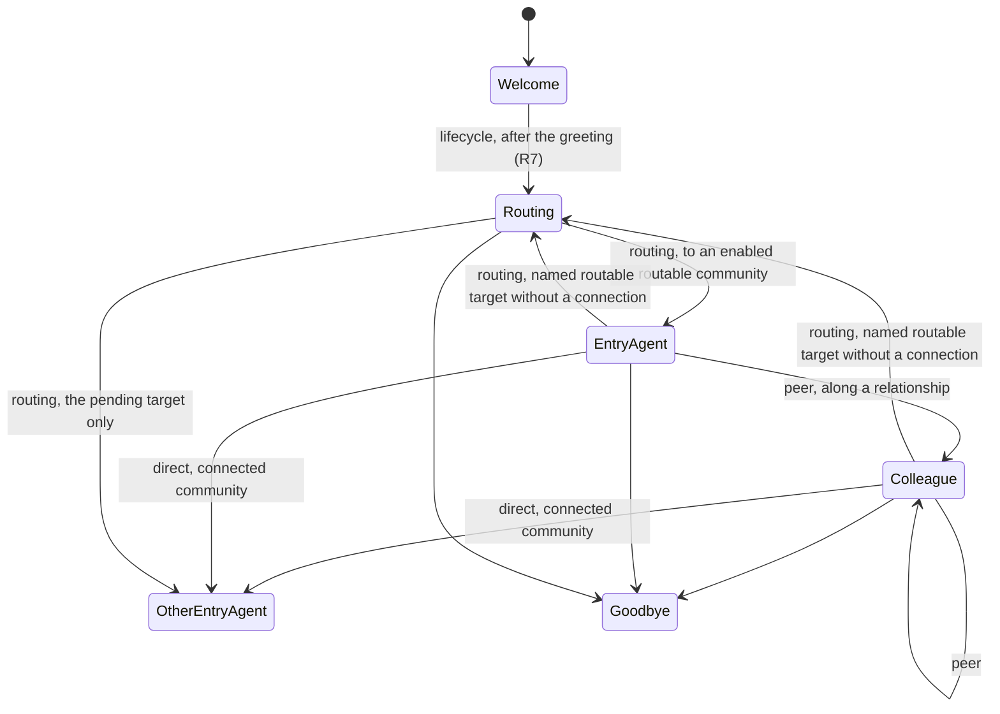

# Data Model: Shared Conversation History Across Agents

**Feature**: [spec.md](spec.md) | **Plan**: [plan.md](plan.md) | **Research**: [research.md](research.md)

## SharedHistory (runtime, new)

One per conversation. In voice it lives in the `ConversationExecutor` for the session and is purged at session end. In text it is loaded from and saved to the text history document (TextConversation v2).

| Field | Type | Rules |
|-------|------|-------|
| `entries` | list of HistoryEntry | Ordered by `at_ms` (voice) or by insertion (text). At most 2,048 entries; a new entry beyond that triggers condensing (R11). |
| `rendered_bytes` | int | UTF-8 size of the model input rendered from `entries`. Above 192 KiB, condensing runs (R11). Above 256 KiB after condensing, `conversation_context_limit` ends the conversation. |
| `condensed` | bool | True once a `condensed` entry exists. |

The rendering to model input is defined in [shared-history.md](contracts/shared-history.md). The voice assistant never receives a SharedHistory (FR-013).

## HistoryEntry (runtime, new)

| Field | Type | Rules |
|-------|------|-------|
| `kind` | enum | `user_text`, `caller_speech`, `assistant_speech`, `agent_answer`, `delegation_result`, `tool_call`, `tool_result`, `handover`, `progress`, `condensed` |
| `agent_id` | Identifier or null | The agent active when the entry was made; null for `caller_speech`, `user_text` and `assistant_speech` |
| `community_id` | Identifier or null | The active community at that time |
| `at_ms` | float or null | Session timeline position (voice: transcript `start_ms` or delegation `offset_ms`); null in text |
| `content` | string | Untrusted text. At most 64 KiB for one entry; longer tool results are cut with "[cut]". |
| `delivery` | enum or null | Voice only: `transcribed`, `partial` (transcription incomplete at the wait's end, FR-024), `not_delivered` (parts of a delegation result never passed on, FR-004) |
| `call_id` | string or null | For `tool_call`, `tool_result` and `handover`: the SDK call id that pairs call and output |
| `name` | string or null | For `tool_call`, `tool_result` and `handover`: the tool or handoff name |
| `handover` | Handover or null | For `kind = handover` |
| `state` | enum or null | For `kind = progress`: `completed`, `failed`, `cancellation_confirmed`, `waiting_for_input` (feature 006 history states) |

**Never stored**: agent instructions, layers, additions, voice conversation instructions, delegation updates, tool definitions, reasoning items, credentials, configuration (FR-005).

**Kept verbatim when condensing** (R11):

- every `handover` entry;
- every `progress` entry;
- the `user_text` or `caller_speech` entry directly after an `agent_answer` or `delegation_result` whose content ends with a question mark, or after a `waiting_for_input` progress entry (a user confirmation, FR-016).

## Handover (runtime, new)

| Field | Type | Rules |
|-------|------|-------|
| `source_agent_id`, `source_role` | Identifier, role | The requesting agent |
| `destination_agent_id`, `destination_role` | Identifier, role | The destination: a colleague, an entry agent, Routing, Goodbye |
| `target_community_id` | Identifier or null | For `path = routing`: the named community; otherwise the destination's community |
| `path` | enum | `peer` (within a community), `direct` (to a connected community's entry agent), `routing` (to Routing with a named target, or from Routing to the target's entry agent), `lifecycle` (Welcome → Routing, R7) |
| `outcome` | enum | `applied`, `refused` |
| `reason` | enum | `applied`, `refused_graph`, `refused_stale`, `refused_budget`, `refused_step_limit` |

**State transitions** (FR-008):

A refused handover leaves the state unchanged and adds a `handover` entry with `outcome = refused`.

## ConversationPolicy state (runtime, changed)

| Field | Change |
|-------|--------|
| `slot.agent_epoch` | Still rises on every applied handover; it is now the only fence for replaced work in voice (FR-010) |
| `slot.generation` | In speech, no longer rises on agent changes or interrupts: it stays the same for the whole voice test (R4) |
| `_pending_destination` | Set by the `routing` handoff's `community_id`; only that destination is enabled for Routing during a transfer |
| `transfer_context` | Removed: the receiving agent sees the whole history (FR-007, FR-021) |
| `_retire_speech`, `_continue_speech` | Removed: the voice session is never replaced (FR-013) |
| `interrupt()` | Removed: the Test page has no Interrupt button; its microphone and loudspeaker switches act only in the browser (FR-013) |

## Voice session state (runtime, changed)

| Field | Type | Rules |
|-------|------|-------|
| `live` | LiveSegment | Exactly one per voice test; settled only at session end |
| `last_update_destinations` | tuple of community ids | The reachable set sent in the last delegation update. An update is sent only when it differs (R5). |
| `delegation_updates` | bool | From `CALLER_VOICE_DELEGATION_UPDATES`. When false, the static delegation block is part of the start instructions. |
| `transcription_wait_seconds` | float | From `CALLER_TRANSCRIPTION_WAIT_SECONDS`, 0–2, default 0.5 |

The Test page's microphone and loudspeaker switches are handled in the browser only and change no runtime state.

## TextConversation v2 (runtime, Cosmos container `text-conversations`)

| Field | Type | Rules |
|-------|------|-------|
| `id` | Identifier | Unchanged |
| `ownerKey` | Digest | Partition key, unchanged |
| `historyVersion` | `2` | New. A document without it is closed (FR-025). |
| `entries` | list of HistoryEntry (stored form) | Replaces `turns`; at most 2,048 |
| `activeAgentId`, `activeCommunityId` | Identifier | Unchanged; revalidated on resume as today |
| `pendingDestination` | Identifier or null | New. A Routing transfer in progress survives between requests. |
| `createdAt`, `updatedAt` | Aware time | Unchanged |
| `ttl` | seconds | 30 days, reset on every update (unchanged) |

**Validation**: document ≤ 512 KiB; rendered history ≤ 256 KiB; owner check on load (unchanged).

**Lifecycle**:

| Situation | Result |
|-----------|--------|
| No document | New conversation from Welcome |
| `historyVersion` absent | `closed`: new conversation with a new id; the old document expires |
| v2 document | Resumed with all entries |
| Revalidation fails | Restart from Welcome with the entries kept (as today) |

## Configuration schema 2.3.0 (management-owned, runtime-read)

| Field | Type | Rules |
|-------|------|-------|
| `agents[].description` | string, optional | ≤ 1 KiB; editor-only; describes the agent as a handover destination (FR-029) |
| `conversationSettings.announceAgentChanges` | bool, optional | Default `false`; editor-only (FR-026) |
| `relationships[].allowedContextFields`, `communityConnections[].allowedContextFields` | unchanged | Still accepted and kept; no longer read by the runtime (FR-021) |
| `communityConnections[]` | unchanged | Now means a direct path to the target community's entry agent (FR-008) |

Absent fields resolve to defaults. Management writes `2.3.0` only when one of the new fields is present ([configuration-v2.3.md](contracts/configuration-v2.3.md)).

## Runtime settings (environment, new)

| Variable | Type | Default | Range |
|----------|------|---------|-------|
| `CALLER_TRANSCRIPTION_WAIT_SECONDS` | float | 0.5 | 0–2 |
| `CALLER_REASONING_EFFORT` | enum | `low` (P2: `minimal` is refused with tools) | `minimal`, `low`, `medium` |
| `CALLER_VOICE_DELEGATION_UPDATES` | bool | `false` (P1: updates interrupt speech) | `true`, `false` |

Invalid values stop the runtime at startup (`settings_invalid`), as for the existing settings.
